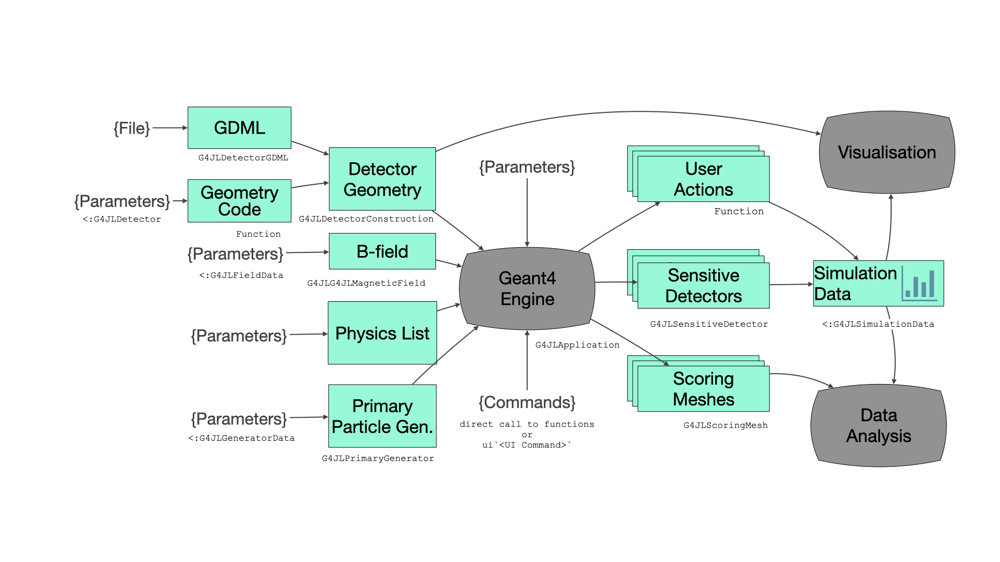

# User Guide

A Geant4 application in Julia is an instance of [`G4JLApplication`](@ref). It brings together everything needed for a simulation: the detector geometry, the physics list, the primary particle generator, an optional field, the user actions, the sensitive detectors and the scoring meshes.



## The application

You create the application with keyword arguments. You need at least a detector; everything else has a default.

```julia
app = G4JLApplication(detector = mydetector,              # detector with its parameters
                      simdata = MySimData(),              # data collected during the simulation
                      generator = G4JLGunGenerator(...),  # primary particle generator
                      field = G4JLUniformMagField(G4ThreeVector(0, 0, 1tesla)),
                      nthreads = 4,                       # number of worker threads (0 = sequential)
                      physics_type = FTFP_BERT,           # physics list
                      stepaction_method = mystepping,     # user actions
                      endeventaction_method = myendevent,
                      sdetectors = ["Chamber_LV+" => chamber_SD],   # sensitive detectors
                      scorers = [mesh1])                  # scoring meshes
```

| Keyword | Default | Description |
|:--------|:--------|:------------|
| `detector` | an empty world | A [detector](@ref "Detector geometry") structure, a subtype of `G4JLDetector` |
| `simdata` | `G4JLNoData()` | User data collected during the simulation, a subtype of `G4JLSimulationData`. See [Simulation data and multi-threading](@ref) |
| `generator` | `G4JLGunGenerator()` | [Primary particle generator](@ref "Primary particle generators") |
| `field` | `nothing` | Magnetic or electric [field](@ref "Fields") |
| `evtdisplay` | `nothing` | [Event display](@ref "Visualization"), from `G4JLEventDisplay()` |
| `nthreads` | `0` | Number of worker threads. `0` runs sequentially; any value above 0 uses Geant4 multi-threading with a `G4MTRunManager` |
| `verbose` | `0` | Verbosity level of the physics list |
| `physics_type` | `FTFP_BERT` | [Physics list](@ref "Physics list") type |
| `runmanager_type` | `G4RunManager` | Run manager type, ignored when `nthreads > 0` |
| `*action_method` | `nothing` | [User actions](@ref) |
| `sdetectors` | `[]` | [Sensitive detectors](@ref), as pairs `"logical volume name" => sd` |
| `scorers` | `[]` | [Scoring meshes](@ref) |

Once the application exists, you control it with these functions:

- [`configure(app)`](@ref configure): sets up the run manager with the physics list, the generator and the user actions.
- [`initialize(app)`](@ref initialize): constructs the geometry, initializes the physics and attaches the sensitive detectors and the field.
- [`beamOn(app, nevents)`](@ref beamOn): runs `nevents` events. You can call it as many times as you like.
- [`reinitialize(app, detector)`](@ref reinitialize): replaces the detector with a new instance, for example with different parameters, before the next `beamOn`.

Geant4 UI commands can be applied at any point with the `ui` string macro:

```julia
ui`/tracking/verbose 1`
ui`/run/printProgress 100`
```

## Detector geometry

The detector parameters are kept in a structure that is a subtype of `G4JLDetector`. You also provide a function that builds the geometry from these parameters and returns the world physical volume. You register it by specializing `Geant4.getConstructor`:

```julia
using Parameters   # optional, for structures with default values

@with_kw mutable struct B2aDetector <: G4JLDetector
    chamberRadius::Float64 = 20cm
    checkOverlaps::Bool = true
end

function construct(det::B2aDetector)::CxxPtr{G4VPhysicalVolume}
    (; chamberRadius, checkOverlaps) = det
    ...
    return worldPV
end

Geant4.getConstructor(::B2aDetector) = construct
```

Inside the construction function, you use the Geant4 classes directly: solids (`G4Box`, `G4Tubs`, `G4Cons`, ...), `G4LogicalVolume`, `G4PVPlacement`, `G4PVReplica`, and materials from `G4NistManager`. Pass solids to `G4LogicalVolume` with [`move!`](@ref) so that Geant4 takes ownership of them (see [Object ownership](@ref)):

```julia
trackerS  = G4Tubs("tracker", 0, trackerSize, trackerSize, 0, 360deg)
trackerLV = G4LogicalVolume(move!(trackerS), m_air, "Tracker")
G4PVPlacement(nothing,              # no rotation
    G4ThreeVector(0,0,0),           # at (0,0,0)
    trackerLV,                      # its logical volume
    "Tracker",                      # its name
    worldLV,                        # its mother volume
    false,                          # no boolean operations
    0,                              # copy number
    checkOverlaps)                  # checking overlaps
```

`G4PVPlacement` accepts `nothing` for "no rotation" and "no mother volume".

### GDML

To read a detector from a GDML file, use [`G4JLDetectorGDML`](@ref):

```julia
detector = G4JLDetectorGDML("TestEm3.gdml"; check_overlap = false)
```

## Physics list

`physics_type` takes one of the predefined Geant4 reference physics lists, for example `FTFP_BERT`, `QGSP_BIC`, `QBBC` or `QGSP_BERT_HP`. To change the physics, define a subtype of `G4VUserPhysicsList` whose constructor starts from a reference list and modifies it:

```julia
struct ScintPhysicsList <: G4VUserPhysicsList
    function ScintPhysicsList(verbose)
        pl = FTFP_BERT(verbose)
        # replace the standard EM physics with option 4
        ReplacePhysics(pl, move!(G4EmStandardPhysics_option4(verbose)))
        # add optical physics
        RegisterPhysics(pl, move!(G4OpticalPhysics(verbose)))
        optpar = G4OpticalParameters!Instance()
        SetProcessActivation(optpar, "Scintillation", true)
        SetProcessActivation(optpar, "Cerenkov", true)
        return pl
    end
end

app = G4JLApplication(; physics_type = ScintPhysicsList, ...)
```

## Fields

The `field` argument sets a global field.

- **Uniform magnetic field**: `G4JLUniformMagField(G4ThreeVector(0, 0, 1tesla))`.
- **Uniform electric field**: `G4JLUniformElectricField(G4ThreeVector(0, 1e8volt/cm, 0))`. The electric field equation of motion and stepper are set up for you. See the [field02](@ref "Extended/field02 Example") example.
- **Custom field**: define a data structure that is a subtype of `G4JLFieldData` and a function that fills in the field value at a given position. Then create a [`G4JLMagneticField`](@ref) or a [`G4JLElectricField`](@ref):

```julia
mutable struct QuadrupoleData <: G4JLFieldData
    gradient::Float64
end

function getfield!(field::G4ThreeVector, pos::G4ThreeVector, data::QuadrupoleData)::Nothing
    g = data.gradient
    assign(field, G4ThreeVector(g * y(pos), g * x(pos), 0))   # assign the result in place
    return
end

bfield = G4JLMagneticField("Quadrupole", QuadrupoleData(1tesla/m); getfield_method = getfield!)
```

To set a field on a single volume, create a `G4FieldManager` and pass it as the fourth argument of `G4LogicalVolume`.

## Primary particle generators

### Particle gun

[`G4JLGunGenerator`](@ref) wraps a `G4ParticleGun`, which produces one particle type with a fixed energy, position and direction:

```julia
G4JLGunGenerator(particle = "proton",
                 energy = 3GeV,
                 direction = G4ThreeVector(0,0,1),
                 position = G4ThreeVector(0,0,-2940.0))
```

### General particle source

[`G4JLGeneralParticleSource`](@ref) wraps a `G4GeneralParticleSource`. It can combine several sources, each with its own distributions for energy, position and angle:

```julia
src1 = (particle="e+", intensity=0.5,
        ene=(type="Exp", min=2MeV, max=10MeV, ezero=2.),
        pos=(type="Plane", shape="Circle", centre=G4ThreeVector(1cm,2cm,0cm), radius=3cm),
        ang=(type="cos", mintheta=0deg, maxtheta=180deg))
src2 = (particle="gamma", intensity=0.5,
        ene=(type="Brem", min=2MeV, max=10MeV, temp=2e12),
        pos=(type="Plane", shape="Ellipse", centre=G4ThreeVector(3cm,1cm,0cm), halfx=1cm, halfy=2cm),
        ang=(type="iso", mintheta=0deg, maxtheta=180deg))
gps = G4JLGeneralParticleSource(sources = [src1, src2])
```

It also accepts the same arguments as the particle gun. See the [GPS](@ref "Extended/GPS Example") example for more distributions.

### Custom generator

A custom generator needs three things:

- a data structure, a subtype of `G4JLGeneratorData`
- an initialization function `(data, app)`, called once in each thread when the application is configured
- a generation function `(event::G4Event, data)`, called for each event

Pass all three to [`G4JLPrimaryGenerator`](@ref):

```julia
mutable struct PlaneSourceData <: G4JLGeneratorData
    particleName::String
    particlePtr::CxxPtr{G4ParticleDefinition}
    energy::Float64
    halfx::Float64
    halfy::Float64
    position::G4ThreeVector
    direction::G4ThreeVector
end

function PlaneSource(; particle="gamma", energy=0.07MeV, halfx=7cm, halfy=7cm,
                       position=G4ThreeVector(0,0,-14.9cm), direction=G4ThreeVector(0,0,1))
    data = PlaneSourceData(particle, CxxPtr{G4ParticleDefinition}(C_NULL), energy, halfx, halfy, position, direction)
    function init(data::PlaneSourceData, app::G4JLApplication)
        data.particlePtr = FindParticle(data.particleName)
    end
    function generate(evt::G4Event, data::PlaneSourceData)::Nothing
        mass = data.particlePtr |> GetPDGMass
        momentum = √((mass + data.energy)^2 - mass^2)
        pvec = momentum * data.direction
        pos = data.position + G4ThreeVector(data.halfx * (rand() - 0.5), data.halfy * (rand() - 0.5), 0)
        primary = G4PrimaryParticle(data.particlePtr, x(pvec), y(pvec), z(pvec))
        vertex = G4PrimaryVertex(pos, 0ns)
        SetPrimary(vertex, move!(primary))    # Geant4 takes ownership of the primary
        AddPrimaryVertex(evt, move!(vertex))  # and of the vertex
    end
    G4JLPrimaryGenerator("PlaneSource", data; init_method=init, generate_method=generate)
end
```

## User actions

User actions are ordinary Julia functions that Geant4 calls during the simulation. Pass them to `G4JLApplication` with these keywords:

| Keyword | Called | Signature |
|:--------|:-------|:----------|
| `beginrunaction_method` | at the start of each run | `(::G4Run, ::G4JLApplication)::Nothing` |
| `endrunaction_method` | at the end of each run | `(::G4Run, ::G4JLApplication)::Nothing` |
| `begineventaction_method` | at the start of each event | `(::G4Event, ::G4JLApplication)::Nothing` |
| `endeventaction_method` | at the end of each event | `(::G4Event, ::G4JLApplication)::Nothing` |
| `pretrackaction_method` | when a track starts | `(::G4Track, ::G4JLApplication)::Nothing` |
| `posttrackaction_method` | when a track ends | `(::G4Track, ::G4JLApplication)::Nothing` |
| `stepaction_method` | after each step | `(::G4Step, ::G4JLApplication)::Nothing` |
| `stackaction_method` | for each new track | `(::G4Track, ::G4JLApplication)::G4ClassificationOfNewTrack` |
| `statechange_method` | when the Geant4 application state changes | `(from::G4ApplicationState, to::G4ApplicationState, ::G4JLApplication)::Bool` |

The class reference lists what you can get from [G4Run](https://geant4.kek.jp/Reference/11.4.1/classG4Run.html), [G4Event](https://geant4.kek.jp/Reference/11.4.1/classG4Event.html), [G4Track](https://geant4.kek.jp/Reference/11.4.1/classG4Track.html) and [G4Step](https://geant4.kek.jp/Reference/11.4.1/classG4Step.html). For example:

```julia
function stepping(step::G4Step, app::G4JLApplication)::Nothing
    volume = step |> GetPreStepPoint |> GetTouchable |> GetVolume
    String(GetName(volume)) == "Absorber" || return
    getSIMdata(app).edep += GetTotalEnergyDeposit(step)
    return
end
```

Every action receives the application, so it can reach the detector (`app.detector`), the generator (`app.generator`) and the simulation data ([`getSIMdata(app)`](@ref getSIMdata)).

!!! warning
    User actions are called very often, so keep them type-stable and avoid allocating memory in them. In multi-threaded mode they run concurrently, so they must only modify the data of their own thread (see the next section).

## Simulation data and multi-threading

Data collected during the simulation (counters, histograms, hits, ...) goes in a mutable structure that is a subtype of `G4JLSimulationData`. The application keeps one copy for each thread, in `app.simdata`:

- `app.simdata[1]` belongs to the master thread (or the only thread, in sequential mode).
- `app.simdata[2:end]` belong to the worker threads.

Within a user action, [`getSIMdata(app)`](@ref getSIMdata) returns the copy for the current thread. To get the totals at the end of a run, add the worker copies to the master copy in the end-of-run action of the master thread:

```julia
function endrun(run::G4Run, app::G4JLApplication)::Nothing
    if G4Threading!G4GetThreadId() < 0       # master thread
        data = app.simdata[1]
        for d in app.simdata[2:end]
            add!(data, d)                    # user-defined merge function
        end
        # ... print or plot the results
    end
    return
end
```

Clear the data at the start of each run (in `beginrunaction_method`) so that consecutive `beamOn` calls don't accumulate.

To print from a worker thread, use `G4JL_println`. It writes through the Geant4 output stream, adds the thread prefix and is thread-safe.

## Sensitive detectors

A sensitive detector collects hits in one or more logical volumes. It is made of a data structure (a subtype of `G4JLSDData`) and up to three functions, which receive the data structure as their **last** argument:

| Keyword | Called | Signature |
|:--------|:-------|:----------|
| `processhits_method` (required) | for each step in the volume | `(::G4Step, ::G4TouchableHistory, data)::Bool` |
| `initialize_method` | at the start of each event | `(::G4HCofThisEvent, data)::Nothing` |
| `endofevent_method` | at the end of each event | `(::G4HCofThisEvent, data)::Nothing` |

`processhits_method` returns `true` when the step produced a hit. This example, adapted from [B2a](@ref "Basic/B2a Example"), collects the hits in a vector. `GetPosition` returns a reference to Geant4 data that changes after the step, so the hit stores a copy of its coordinates:

```julia
struct TrackerHit
    trackID::Int32
    chamberNb::Int32
    edep::Float64
    pos::NTuple{3,Float64}
end

struct B2aSDData <: G4JLSDData
    trackerHits::Vector{TrackerHit}
    B2aSDData() = new([])
end

function _initialize(::G4HCofThisEvent, data::B2aSDData)::Nothing
    empty!(data.trackerHits)
    return
end

function _processHits(step::G4Step, ::G4TouchableHistory, data::B2aSDData)::Bool
    edep = step |> GetTotalEnergyDeposit
    edep < 0. && return false
    pos = step |> GetPostStepPoint |> GetPosition
    push!(data.trackerHits, TrackerHit(step |> GetTrack |> GetTrackID,
                                       step |> GetPreStepPoint |> GetTouchable |> GetCopyNumber,
                                       edep, (x(pos), y(pos), z(pos))))   # copy the position
    return true
end

chamber_SD = G4JLSensitiveDetector("Chamber_SD", B2aSDData();
                                   processhits_method = _processHits,
                                   initialize_method = _initialize)
```

Then attach it to logical volumes by name. A trailing `+` attaches it to every logical volume with that name, not only the first one:

```julia
app = G4JLApplication(; sdetectors = ["Chamber_LV+" => chamber_SD], ...)
```

From a user action, [`getSDdata(app, "Chamber_SD")`](@ref getSDdata) returns the sensitive detector data for the current thread.

## Scoring meshes

Scoring meshes accumulate quantities on a grid without any user code. In C++ Geant4 you set them up with `/score/...` UI commands; here you create them with [`G4JLScoringMesh`](@ref). For example, from [RE03](@ref "Extended/RE03 Example"):

```julia
sc1 = G4JLScoringMesh("boxMesh_1",
                      BoxMesh(1m, 1m, 1m),
                      bins = (30, 30, 30),
                      quantities = [ energyDeposit("eDep")
                                     nOfStep("nOfStepGamma", filters=[ParticleFilter("gammafilter", "gamma")])
                                     nOfStep("nOfStepEMinus", filters=[ParticleFilter("eMinusFilter", "e-")])
                                     nOfStep("nOfStepEPlus", filters=[ParticleFilter("ePlusFilter", "e+")])
                                   ])

app = G4JLApplication(; scorers = [sc1], ...)
```

The mesh can be a `BoxMesh` or a `CylinderMesh`. The available quantities are `energyDeposit`, `doseDeposit` and `nOfStep`, each with optional filters.

After a run, each quantity can be read as a property of the mesh. It returns the sum, the sum of squares and the number of entries, as Julia arrays with the shape of the bins:

```julia-repl
julia> beamOn(app, 10000)

julia> sum, sum2, entries = sc1.eDep;

julia> size(sum)
(30, 30, 30)
```

## Visualization

Visualization comes from the `G4Vis` extension, which is activated when you load a Makie backend: `CairoMakie` for static images (notebooks, documentation) or `GLMakie` for interactive 3D windows.

### Drawing geometry

`draw` renders a solid, a logical volume or a physical volume; `draw!` adds it to an existing scene:

```julia
using GLMakie

draw(G4Box("box", 10cm, 10cm, 10cm), color=:green)
draw(GetWorldVolume(), wireframe=true, maxlevel=3)   # the geometry of the current application
```

The [Solids](@ref "Geant4 Solids") and [GDML rendering](@ref "GDML rendering example (CMS)") examples show more options.

### Event display

To display the geometry with the trajectories of each event, pass a `G4JLEventDisplay` to the application:

```julia
evtdisplay = G4JLEventDisplay(joinpath(@__DIR__, "B2aVisSettings.jl"))
app = G4JLApplication(; evtdisplay = evtdisplay, ...)
```

The optional settings file contains a Julia `NamedTuple`. It overrides the defaults in [`ext/G4Vis/settings.jl`](https://github.com/JuliaHEP/Geant4.jl/blob/master/ext/G4Vis/settings.jl), which include the background color, resolution, camera, trajectory color and how deep the detector hierarchy is drawn:

```julia
(
    display = (
        show_axis = false,
    ),
    trajectories = (
        color = :yellow,
    ),
)
```

After each `beamOn`, `evtdisplay.figure` holds the figure of the last event. See the [B2aVis](@ref "Basic/B2a Event Display Example") example.

## Histograms

The `G4Hist` extension is activated when you load [FHist](https://github.com/Moelf/FHist.jl). It provides `H1D` and `H2D`: histograms that carry a title and a unit, and support `push!`, `merge!` and `empty!`. That makes them convenient inside simulation data structures:

```julia
using FHist
h = H1D("Energy deposit", 100, 0., 10., :MeV)
push!(h, edep)            # edep in Geant4 internal units, stored in MeV
```
